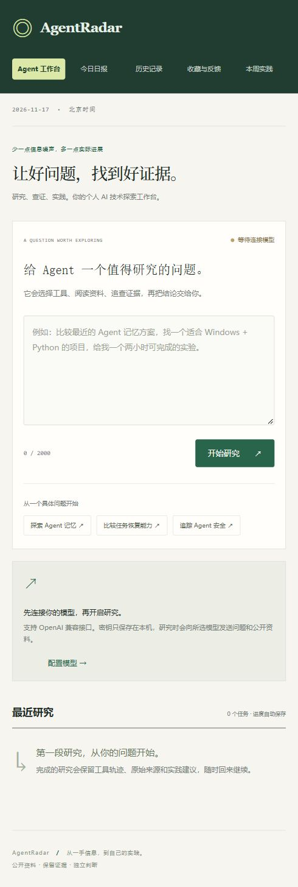

# AgentRadar

面向个人学习与工程实践的 AI 技术研究 Agent，提供 Windows 桌面软件、命令行及可选本地 Web 工作台。桌面窗口复用原生 Function Calling Agent，保留证据、预算、SQLite 持久化与暂停恢复。

## Windows 桌面版

构建完成后双击 **`dist/windows/AgentRadar/AgentRadar.exe`**。分发时复制整个 `AgentRadar` 文件夹（包括 `_internal`），或运行 `scripts/Build-Desktop.ps1` 生成 Windows 压缩包。完整解压后双击其中的 EXE。桌面版默认数据目录为 `%LOCALAPPDATA%\AgentRadar`；CLI 默认仍使用项目目录，两者不会自动混写。

开发环境也可以双击 `启动桌面版.cmd`。需要 Windows 10/11、.NET 4.x 与 [Microsoft Edge WebView2 Runtime](https://developer.microsoft.com/microsoft-edge/webview2/)。窗口优先使用 WebView2，失败时不会降级到旧 IE 内核。

- **概览 / 每日情报 / 自主研究**：查看真实数据、更新日报、提问、查看工具轨迹与引用、暂停/恢复和导出。
- **信息源管理**：添加、编辑、删除、启停 GitHub Releases、GitHub 搜索、arXiv 分类/搜索及通用 RSS/Atom；设置关键词和数量，测试连接或直接入库，查看检查时间、结果数量与失败原因。来源配置保存在 SQLite，首次从原 `config.json` 导入。
- **大模型配置**：创建多个兼容服务档案，配置用途、模型 ID、Token 参数、JSON 模式和预算。保存后选择“使用此模型”。可读取服务的 `/models` 列表，也可手动填写 Model ID。本地无认证兼容服务的密钥填写 `local`。
- **模型能力验证**：真实请求依次验证基本响应、原生 `tool_calls` 和参数、工具观察回传与 JSON 结果。最多 3 次模型调用，计入每日预算；失败阶段会明确显示。
- **安全凭据**：新模型配置只在 Windows Credential Manager 保存 API Key，数据库仅存凭据引用；读取接口不返回密钥。旧 CLI `.env` 仍兼容，迁移不会自动复制其中的密钥。凭据管理器不可用时明确失败，不回退明文。
- **知识库与收藏**：搜索最近 500 条已采集信息，收藏、标记有用或记录实践完成；实践页沿用现有任务卡。
- **自动任务 / 运行状态**：可选择窗口内运行，或勾选“关闭窗口后也运行”登记 Windows 任务。系统模式使用北京时间，需电脑开机且当前用户已登录。自动任务页保留最近后台采集时间、条数和失败或跳过原因。最近 15 次采集的真实状态可查。
- **系统设置**：浅色冰透、深色、低透明度主题和减少动画；显示当前数据目录。

### 关闭、并发与兼容性

桌面版绑定 `127.0.0.1` 的系统分配端口，持有监听套接字以避免端口争用。同一用户数据目录只允许一个桌面实例；第二次启动会提示已有实例。写接口保留 Origin/CSRF 校验。

关闭窗口会禁止新任务、请求研究暂停，并等待当前网络操作结束后退出；采集和模型测试会等待当前任务完成，因此关闭可能需要一段时间。退出后没有隐藏常驻采集进程。自动任务页可登记或移除本数据目录的 Windows 计划。原 CLI 计划独立存在，如已启用旧计划，请选择一份使用。

模型切换不删除历史或清空预算。新研究记录不含密钥的模型签名；恢复需使用相同服务、模型及协议选项。旧版尚无签名的任务第一次恢复时记录当前签名。分析缓存继续按服务地址、模型、输入和提示版本区分。

通用 RSS 仅接受公网 HTTPS/443：检查地址和 DNS 全部结果，再固定已校验 IP 建立 TLS 连接并验证原域名。拒绝重定向、私网、本机、实体声明、未请求压缩及超过 4 MiB 的响应；此路径不经过系统代理，避免代理端重新解析绕过校验。需要代理才能直连的订阅会明确失败，不会降低此限制。GitHub/arXiv 固定主机采集仍支持原有网络环境。

### 首次迁移

目标必须是空目录。关闭旧任务后运行（替换示例路径）：

```powershell
.\dist\windows\AgentRadar\AgentRadar.exe --migrate-from '旧 AgentRadar 项目目录'
```

原目录不修改；使用 SQLite backup 复制日报、研究任务、证据和反馈，复制报告及非敏感来源配置。密钥不迁移，请在新模型中心重新输入。已存在桌面数据时拒绝覆盖；需要单独试迁移可加 `--data-dir '新的空目录'`。迁移不复制旧任务调度设置。

### 源码安装与构建

```powershell
python -m venv .venv
.\.venv\Scripts\python.exe -m pip install -r requirements-desktop.lock.txt
.\.venv\Scripts\python.exe desktop.py
.\.venv\Scripts\python.exe -m pytest -q
.\.venv\Scripts\python.exe -m PyInstaller AgentRadar.spec --distpath dist/windows --noconfirm
```

锁定依赖对应本次 Windows/Python 3.14 构建；其他 Python 版本可先按 `requirements-desktop.in` 安装兼容版本后重新验证。`AgentRadar.spec` 显式包含模板、CSS、JS、默认配置和 pywebview 资源；不包含 `.env`、本机数据库、日志和报告。构建产物和本地数据均被 Git 忽略。构建工具只用于开发与打包，分发目录自带解释器。

### 桌面升级验证范围

详细结果见 [桌面验收记录](docs/DESKTOP-VALIDATION.md)，实施审查与参考来源见 [实施计划](docs/DESKTOP-PLAN.md)。模拟模型测试不等于真实服务兼容性或研究质量验收；本机 EXE 启动不等于干净 Windows 机器验收。

## 原有 CLI 与 Web 使用方式

## 可视化工作台

双击 `打开AgentRadar.cmd`，或运行 `python radar.py serve` 后访问 `http://127.0.0.1:8765`。

- 在首页输入研究问题，或使用快捷问题作为起点。
- 实时查看工具调用轨迹、证据列表和研究阶段。
- 在任务页暂停、恢复研究；暂停会等待当前网络请求结束后保存进度。
- 阅读带证据 ID 的结论、实践建议和限制，展开原始摘录，导出 Markdown。
- 在“模型与连接设置”填写本机配置；缺少模型时明确提示，不伪造研究结果。
- 保留今日日报、历史、反馈与本周实践入口；支持窄窗口布局。



任务页展示真实运行状态；离线集成测试覆盖开始、暂停、恢复、忙碌冲突和结果读取。截图中的空任务状态是当前实际配置状态，不代表已经完成真实模型研究。

## 两种工作方式

**每日雷达 `run`**：从 GitHub Releases、仓库搜索和 arXiv RSS 采集公开资料，去重保存，按兴趣选候选。配置模型后生成中文分析，并针对重点条目有限补查；未配置模型时明确输出原文基础报告。

**自主研究 `research`**：给一句研究目标，模型通过原生 Chat Completions function calling 自主选择工具；读取观察结果，再决定继续查证或提交结论。任务状态、证据和执行记录保存在本机，可中断恢复。

```text
研究目标 → 模型决策 → 参数校验 → 只读工具 → 证据与观察
              ↑                              │
              └──────────────────────────────┘
                        ↓
              引用检查 → 中文结论 / 信息不足
```

## 开始使用（当前电脑）

项目位于 `D:\个人项目\AgentRadar`，独立 Python 环境已创建。

1. 双击 `配置模型.cmd`，在本机输入兼容 API 地址、模型名称和 API Key；密钥输入不显示。接口地址通常包含 `/v1`，不要附加 `/chat/completions`。
2. 双击 `开始研究.cmd`，输入研究目标。也可以在 PowerShell 执行：

```powershell
Set-Location 'D:\个人项目\AgentRadar'
.\.venv\Scripts\python.exe radar.py research '最近有哪些适合 Windows Python 项目实践的 Agent 记忆方案？比较原始资料与限制，给一个两小时的小实验。'
```

程序会输出当前调用的工具、返回状态、任务 ID 和报告路径。结果保存在 `reports/research/<任务ID>.md` 与 `.json`，不需要启动网页。

**当前尚未配置真实模型接口。** 缺少配置时 `research` 会明确退出，不伪装成模型完成的研究。已完成离线模拟模型的工具循环测试；真实服务的兼容性、输出质量和费用仍需填写配置后验证。

API 服务需要支持 Chat Completions 原生 `tools`/`tool_calls`。仅提供纯文本聊天的接口无法驱动这套研究循环。`config.json` 中的 `llm.token_parameter` 可设为 `max_tokens`（默认）或 `max_completion_tokens`，以匹配服务商要求。

## 常用命令

以下命令均在项目目录执行，`python` 指 `.venv\Scripts\python.exe`。

| 命令 | 作用 |
|---|---|
| `python radar.py configure` | 在终端安全填写本机模型配置 |
| `python radar.py doctor` | 检查 Python、模型配置完整性和本地记录数；不显示密钥 |
| `python radar.py run` | 手动生成今日日报，使用当前模型配置 |
| `python radar.py research "研究目标"` | 开始自主研究 |
| `python radar.py tasks` | 查看最近研究任务及状态 |
| `python radar.py research --resume 任务ID` | 使用已保存的证据和观察继续任务 |
| `python radar.py feedback 条目ID useful` | 记录有用反馈；也支持 saved、hard、ignore、completed |
| `python radar.py practice` | 从明确标记有用的条目中生成本周任务 |
| `python radar.py export` | 从数据库重新导出最近日报，无需重新采集 |
| `python radar.py serve` | 可选：打开仅绑定本机的阅读服务 |

日报保存在 `reports/latest.html`、`reports/YYYY-MM-DD.html` 和 `.md`。条目 ID 可在 `data/radar.db` 的条目记录、日报记录中查看，或使用可选网页操作反馈。

研究状态 `completed` 表示已形成结构化结论，其中 `outcome=insufficient` 表示证据不足，并不代表技术问题已经查清。`paused` 表示已保存进度；预算耗尽时等待次日或自行调整预算再恢复。恢复不会重复已完成的资料请求；已执行过且失败的相同工具参数会被阻止，可由模型选择其他证据路径。

## Agent 可以调用的工具

| 工具 | 能力与边界 |
|---|---|
| `search_projects` | 搜索公开 GitHub 仓库，最多 5 个候选；关注度不当作质量证据 |
| `read_project` | 读取指定 `owner/name` 的 README；区分项目自述和实测 |
| `read_releases` | 读取最多 3 条版本记录 |
| `search_papers` | arXiv 论文搜索，只读标题和摘要，明确未阅读全文 |
| `search_history` | 查询本地历史条目，不把旧记录当成独立核验 |
| `finish_research` | 提交中文发现、引用、建议和限制；引用 ID 必须确实存在 |

所有外部工具只能访问代码限定的 GitHub/arXiv 主机，不接受任意 URL。没有命令执行、自动安装、项目修改或消息发送工具。README、论文和历史中的指令不能扩大工具权限。

引用校验验证的是“资料确实取得，ID 有效”，不是语义正确性的证明；模型仍可能误读原文，需要你对重要结论核查。离线安全测试验证权限和程序约束，不声称彻底解决提示词注入。

## 自动运行

已安装当前用户的 Windows 任务 `AgentRadar-Daily-0830`，每天北京时间 08:30 执行 `scripts/run_daily.py`，普通权限、隐藏窗口，错过触发后尽可能补跑。无需保持网页打开。

本机需要开机、用户已登录且网络可用。任务不会唤醒关机电脑。采集日志存放 `logs/YYYY-MM-DD.log`；失败或部分采集会写入来源状态，已完成的其他来源继续使用。

```powershell
# 查看任务状态
Get-ScheduledTask -TaskName 'AgentRadar-Daily-0830'
Get-ScheduledTaskInfo -TaskName 'AgentRadar-Daily-0830'

# 重新注册此项目的任务
.\scripts\Install-Schedule.ps1

# 移除定时任务，保留代码、数据和报告
.\scripts\Remove-Schedule.ps1
```

脚本不会覆盖同名但指向其他项目的任务。若更换系统时区，请重新注册以重新换算北京时间。任务的 `run` 和手动 `research` 共用进程锁，避免同时执行。

## 配置和费用控制

- `config.json`：主题、来源、候选数量、每日调用预算、每次研究的步骤/工具上限。
- `.env`：本机模型地址、模型名称、API Key；可选 `GITHUB_TOKEN` 仅发送到 GitHub。`.env.example` 不含真实凭据。
- 默认每天最多 24 次模型请求，Token 预留上限 120000；失败和重试也计入，不因重启程序重置。每日预算按北京时间换日。
- 默认每次研究最多 8 个普通模型步骤加一次结束尝试，最多 12 个工具结果；任务的工具上限跨恢复累计。
- 单次任务时间目标为 600 秒，HTTP 请求受剩余时间和单请求超时约束。网络库的分阶段超时可能导致小幅超时；Windows 定时任务另有 12 分钟终止上限。
- Token 按可见输入的 UTF-8 字节数和输出上限保守预留，不是服务商账单的严格计费上限。不同模型可能有额外计费项，应同时设置供应商侧限额。
- 不配置价格时只记录用量，不编造费用。建议先用一个短问题验证模型配置，再运行全天候任务。

配置在本机不等于推理在本机。云端模型会接收研究问题、公开资料和必要偏好；密钥只用于目标模型服务的认证，不转发给资料来源，不写入报告和 Git。

## 数据与恢复

`data/radar.db` 保存条目版本、采集历史、日报、反馈、分析缓存、每日预算和研究任务。工具观察、证据与待执行队列一起提交；中断后可以继续，不能把暂停任务当成已完成。

精确去重按来源、外部 ID 和内容版本执行。arXiv 跨分类条目合并；论文和仓库之间尚未建立完整的跨源事件图，不能保证语义重复全部识别。RSS 是近期快照，搜索和发布记录也有限额，覆盖不足会明确标记 `partial`，不声称抓取了全部前沿进展。

版本发布接口触发限流时可以等待恢复，或在 `.env` 配置自己的 GitHub 令牌；不要把令牌发到聊天或写入代码。被限流的来源不会推进成功检查点。

## 验证与实际限制

测试使用临时数据库、模拟 HTTP 和模拟模型，不消费真实模型额度：

```powershell
.\.venv\Scripts\python.exe -m pytest -q
```

覆盖采集格式、版本去重、限流/失败隔离、凭据隔离、参数校验、原生工具多步调用、证据 ID 校验、预算暂停与恢复、命令注入权限边界、页面写请求校验等。

2026-11-17 工作台更新后的完整测试结果：**78 passed**。另有 1 条测试客户端的依赖弃用提示。

2026-11-17 已真实执行 `run` 并取得 116 条资料。该次 GitHub 发布接口限流，arXiv 与仓库搜索返回有数量上限的结果，生成的是基础报告。没有真实模型输出质量或连续一周稳定性的验证结果；这些不能写成已经达到的项目成绩。

当前环境：Python 3.14.9；安装版本在 `requirements.lock.txt`。后续在新环境可以安装锁定依赖，但本次没有另建第二个环境验证重装可复现性。

## 代码位置

- `agentradar/agent.py`：独立研究 Agent、持久任务状态、证据与恢复。
- `agentradar/model.py`：原生 Chat Completions 工具调用传输。
- `agentradar/research_tools.py`：5 个只读研究工具。
- `agentradar/pipeline.py`、`analysis.py`：每日采集后的筛选与有限研究。
- `agentradar/collectors.py`、`storage.py`：来源连接器及版本化 SQLite。
- `agentradar/reports.py`：Markdown/HTML 导出。
- `agentradar/web.py`、`assets/`：可选阅读与反馈界面。
- `scripts/`：Windows 自动运行与便捷入口。

## 接口资料

- [OpenAI function calling](https://developers.openai.com/api/docs/guides/function-calling)
- [GitHub Releases API](https://docs.github.com/en/rest/releases/releases)
- [GitHub Search API](https://docs.github.com/en/rest/search/search)
- [arXiv RSS](https://info.arxiv.org/help/rss.html)
- [arXiv API](https://info.arxiv.org/help/api/user-manual.html)
